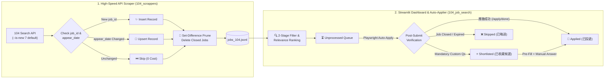

<a id="readme-top"></a>

<div align="center">

# 🚀 Job Search Tools (`Job_Search_Tools`)

**A Production-Grade Recruitment Intelligence, Multi-Dimensional Filtering & Automated Application Platform**

[](./README.md)
[](./README.zh-TW.md)

<br/>

[](https://www.python.org/)
[](https://streamlit.io/)
[](https://playwright.dev/)
[](https://github.com/astral-sh/uv)
[](#-privacy-security--proof-screenshots)

<p align="center">
  <a href="#-key-highlights">✨ Highlights</a> •
  <a href="#-repository-structure">📁 Structure</a> •
  <a href="#️-quick-start--setup">🛠️ Quick Start</a> •
  <a href="#-platform-guide-104-job-bank">💼 104 Guide</a> •
  <a href="#-execution-commands--workflows">⚡ Workflows</a> •
  <a href="#-privacy-security--proof-screenshots">🔒 Privacy</a>
</p>

</div>

---

## ✨ Key Highlights

`Job_Search_Tools` is engineered as a modular, multi-platform career intelligence suite designed to support major regional and international job portals (currently active for **104 Job Bank**, and architected for **Indeed**, **LinkedIn**, **JobStreet**, and **CakeResume**).

<table>
  <tr>
    <td width="50%" valign="top">
      <h3>⚡ Smart 3-in-1 API Synchronizer</h3>
      <ul>
        <li><b>Direct JSON API Ingestion</b>: Bypasses heavy browser rendering to collect full job descriptions, salary bounds, and metadata at 30 postings/request.</li>
        <li><b><code>appear_date</code> Upsert</b>: Cross-checks <code>(job_id, appear_date)</code> in RAM—unchanged postings are skipped in <code>0ms</code>; updated postings are refreshed in place.</li>
        <li><b>Window-Aware Set-Difference Pruning</b>: Automatically purges closed/delisted jobs from <code>jobs_104.jsonl</code> without requiring prior application attempts.</li>
      </ul>
    </td>
    <td width="50%" valign="top">
      <h3>🎯 Precision Filtering & Ranking</h3>
      <ul>
        <li><b>Two-Stage <code>OR</code> + <code>AND</code> Engine</b>: Combines full-text skill keyword matching (Sidebar) with title/company locking (Top Search Bar).</li>
        <li><b>Word-Boundary Regex Protection</b>: Prevents false positives on short English acronyms (e.g., <code>AI</code> won't match <code>email</code>; <code>RAG</code> won't match <code>storage</code>).</li>
        <li><b>Auto-Relevance Sorting (<code>🔥 命中 N 項</code>)</b>: Ranks candidates by title hits and total skill keyword hits so top matches always appear on Page 1.</li>
      </ul>
    </td>
  </tr>
  <tr>
    <td width="50%" valign="top">
      <h3>🤖 Verified Playwright Auto-Applier</h3>
      <ul>
        <li><b>Multi-Browser Support</b>: Runs natively on Brave, Chrome, Edge, or Firefox using persistent local login profiles.</li>
        <li><b>Strict Post-Submit Verification</b>: Verifies 104's official <code>應徵成功</code> confirmation screen and captures audit screenshots.</li>
        <li><b>Smart Auto-Routing</b>: Automatically routes closed jobs to <code>skipped</code> and jobs with mandatory custom questions to <code>shortlisted</code>.</li>
      </ul>
    </td>
    <td width="50%" valign="top">
      <h3>✍️ Semi-Automated Shortlist & Privacy</h3>
      <ul>
        <li><b>Interactive Pre-Fill Mode</b>: Clicking <b>🚀 Apply Now</b> in the <i>Shortlisted</i> tab selects your resume, fills your cover letter, and pauses on the modal for manual questionnaire entry.</li>
        <li><b>100% Local PII Protection</b>: Resumes, cover letters (<code>default_cv.json</code>), application history (<code>user_pipeline.json</code>), and cookies are strictly gitignored.</li>
      </ul>
    </td>
  </tr>
</table>

---

## 🔄 System Architecture & Pipeline Lifecycle



<p align="right">(<a href="#readme-top">⬆️ Back to top</a>)</p>

---

## 📁 Repository Structure

```text
Job_Search_Tools/
├── .gitignore                  # Excludes data, venv, browser sessions, screenshots, and personal PII
├── README.md                   # Documentation (English)
├── README.zh-TW.md             # Documentation (Traditional Chinese / 繁體中文)
│
├── 104/                        # Platform 1: 104 Job Bank Suite (Active)
│   ├── 104_scrappers/          # 104 Web Scrapers & Taxonomy Data
│   │   ├── crawl_listings.py   # 3-in-1 batch listing synchronizer (Insert + Upsert + Prune)
│   │   ├── scraper.py          # Core 104 REST API scraper with anti-ban protections
│   │   └── data/               # Scraper data store
│   │       ├── target_categories.json # Selected categories to crawl (customizable)
│   │       ├── job_categories.json    # Complete 104 official category taxonomy tree
│   │       └── jobs_104.jsonl         # Scraped raw jobs stream (local / gitignored)
│   │
│   └── 104_job_search/         # 104 Interactive Dashboard, Querying & Auto-Applier
│       ├── app.py              # Streamlit interactive dashboard & batch application hub
│       ├── applier.py          # Core Playwright browser automation engine
│       ├── login_tool.py       # One-time browser authorization & session helper
│       ├── db_sync.py          # SQLite synchronization & UPSERT engine
│       ├── query_filter.py     # CLI-based multi-criteria filtering utility
│       ├── browser_data/       # Persistent browser profile & login cookies (gitignored)
│       ├── screenshots/        # Proof-of-application & diagnostic screenshots (gitignored)
│       └── data/               # User state & configuration (gitignored)
│           ├── filter_rules.json      # Negative noise filtering rules
│           ├── default_cv.json        # Custom cover letter templates (local / gitignored)
│           └── user_pipeline.json     # Application progress & status history (local / gitignored)
│
├── indeed/                     # Platform 2: Indeed Suite (Planned)
├── linkedin/                   # Platform 3: LinkedIn Suite (Planned)
└── jobstreet/                  # Platform 4: JobStreet Suite (Planned)
```

---

## 🛠️ Quick Start & Setup

This project uses [`uv`](https://github.com/astral-sh/uv) for fast, isolated Python virtual environments and dependency management.

```bash
# 1. Clone the repository
git clone https://github.com/jeniebeez/Job_Search_Tools.git
cd Job_Search_Tools

# 2. Create virtual environment with Python 3.12 (managed by uv)
uv venv --python 3.12
source .venv/bin/activate

# 3. Install dependencies & Playwright browser drivers
uv pip install requests pandas openpyxl beautifulsoup4 streamlit playwright
playwright install chromium
```

<p align="right">(<a href="#readme-top">⬆️ Back to top</a>)</p>

---

## 💼 Platform Guide: 104 Job Bank (`104/`)

### 1. Submodule Architecture

#### A. High-Efficiency API Scraper (`104/104_scrappers/`)
- **Direct REST API Interface**: Queries 104's internal JSON API endpoints directly, retrieving 30 full job postings (including full descriptions, salary ranges, experience requirements, and update timestamps) per HTTP request.
- **Taxonomy Traversal**: Iterates across 46 configured job categories in `target_categories.json` to bypass 104's 100-page search ceiling.
- **Anti-Ban Protections**:
  - Lightweight randomized page jitter (`0.6s ~ 1.2s` for listing pages; `1.8s ~ 3.5s` for detail pages).
  - Automatic exponential backoff retry on HTTP `429` / `403` responses and User-Agent rotation.
- **Smart 3-in-1 Synchronization (`appear_date` Upsert + Closed Job Pruning + New Job Insertion)**:
  - Running `crawl_listings.py` (defaults to `--is-new 7`) automatically performs three operations:
    1. **Existing Jobs Comparison & Update**: Cross-checks `(job_id, appear_date)` in memory—if `appear_date` is unchanged, the record is skipped immediately (`0` wasted work); if `appear_date` has changed, the record is updated in place (`Upsert`).
    2. **Closed Jobs Deletion (Window-Aware Set-Difference Pruning)**: Computes the set difference (`existing_records - seen_job_ids`) within the active `--is-new` date window (`appear_date >= cutoff_date`) to delete delisted/closed postings directly from `jobs_104.jsonl` without requiring prior application attempts, while also cleaning up or restoring any `"職缺已關閉"` entries in `user_pipeline.json`.
    3. **Brand-New Jobs Insertion**: Appends newly posted `job_id`s into `jobs_104.jsonl`.

#### B. Search & Keyword Filtering Syntax Guide (`app.py`)
The Streamlit dashboard provides a two-stage keyword filtering and relevance-ranking pipeline that combines **OR (Union)** and **AND (Intersection)** logic:

1. **Sidebar `"🏷️ 技能標籤 / 關鍵字過濾"` (Full-Content `OR` Filter + Auto-Relevance Sorting)**:
   - **Searches Full Content**: Matches against `Job Title + Job Categories + Full Job Description`.
   - **Comma Delimiters (`,` or `，`) & Optional Whitespace**: Supports both half-width and full-width commas. Leading/trailing spaces are stripped automatically.
   - **English Word-Boundary Protection**: Pure ASCII keywords (such as `AI`, `RAG`, `LLM`) automatically enforce regex word boundaries `(?<![a-z0-9])...(?![a-z0-9])` so `RAG` never false-matches `storage` and `AI` never false-matches `email`.
   - **Automatic Relevance Sorting (`🔥 命中 N 項`)**: Matching jobs are automatically sorted from highest to lowest by `(1) Title Keyword Hits` and `(2) Total Keyword Hits`.

> [!TIP]
> **Recommended 2-Stage Filtering Strategy**:
> Put your **technical stack keywords** (e.g., `LLM, RAG, LangChain, Multi-Agent, 生成式AI, 生成式 AI, GenAI`) in the **Sidebar Skill Filter**, and put your **target role titles** (e.g., `工程師, Engineer, Developer, 演算法, 研究`) in the **Top Search Bar** with **`🎯 僅職稱與公司名 (精準鎖定)`** selected!

2. **Top `"🔍 即時檢索職缺"` Search Bar (Role / Title `AND` Refinement)**:
   - **`🎯 僅職稱與公司名 (精準鎖定)` (Default)**: Matches **only** the job title and company name.
   - **`📄 全文檢索 (含工作內容)`**: Searches across title, company name, full description, and region.

---

### 2. Job Pipeline Status Definitions (`unprocessed`, `shortlisted`, `applied`, `skipped`)

Every job tracked in `104/104_job_search/data/user_pipeline.json` belongs to one of four lifecycle states, selectable in the sidebar under **"職缺處理狀態"**:

| Status | UI Label | Meaning & Lifecycle Behavior |
| :--- | :--- | :--- |
| **`unprocessed`** | **⏳ 全部未處理** | **Default state** for all newly scraped postings that have not yet been applied to, bookmarked, or skipped. |
| **`shortlisted`** | **⭐ 已收藏候選** | **1. Manual Bookmark / Auto-Routed Mandatory Questionnaire (`⚠️ 含公司必填提問`)**: Jobs you manually starred, or jobs where a company requires custom mandatory questionnaire answers (`此為必填問題`) that blocked automated batch submission.<br>**2. Semi-Automated Pre-Fill Workflow**: Batch auto-apply buttons are hidden in this view. Clicking **`🚀 立即投遞`** opens the browser, selects your resume, **pre-fills your cover letter, and stays open on the application modal** so you can answer the custom questions and submit manually (or click **`✅ 已投遞`** on the card to archive it). |
| **`applied`** | **🚀 已投遞** | **Verified or Manually Archived Submissions**: Jobs where Playwright verified 104's official `應徵成功` (`/job/apply/done`) screen, or jobs you manually marked via the **`✅ 已投遞`** button. Automatically excluded from `Unprocessed`. |
| **`skipped`** | **❌ 已略過** | **1. Manual Skip**: Jobs you manually dismissed via `❌ 略過`.<br>**2. Auto-Routed Closed Job (`❌ 職缺已關閉`)**: If 104 indicates the position is closed during auto-apply, the engine aborts within 1s and moves it to `skipped` (and purges it from `jobs_104.jsonl` on your next `crawl_listings.py` run). |

---

### 3. Cover Letter Management & Customizing Crawl Categories

<details>
<summary><b>📝 Click to expand: Cover Letter Management & Persistence (<code>default_cv.json</code>)</b></summary>
<br/>

1. **Auto-Initialization on First Run**:
   When you launch `streamlit run 104/104_job_search/app.py` for the first time, if `104/104_job_search/data/default_cv.json` does not exist, it is **automatically generated** with starter templates.
2. **Customize in the Web UI or Editor**:
   - Edit directly in the Streamlit sidebar and click **"💾 儲存此模板修改"** or **"➕ 另存為新模板"**.
   - Or edit `104/104_job_search/data/default_cv.json` directly in VS Code.
3. **100% Privacy Guaranteed**:
   `default_cv.json` is gitignored and never uploaded to GitHub.

</details>

<details>
<summary><b>🗂️ Click to expand: How to Customize Crawl Categories & Keywords (<code>target_categories.json</code>)</b></summary>
<br/>

1. **Find Category Codes**:
   Search `104/104_scrappers/data/job_categories.json` for your desired roles (`"no"` = category code, `"des"` = category name).
2. **Edit `target_categories.json`**:
   ```json
   [
     {
       "code": "2007001012",
       "name": "演算法開發工程師",
       "parent_name": "軟體/工程類人員"
     },
     {
       "code": "2007001001",
       "name": "軟體工程師",
       "parent_name": "軟體/工程類人員"
     }
   ]
   ```
3. **On-Demand Keyword Search (`scraper.py`)**:
   ```python
   if __name__ == "__main__":
       scraper = Job104Scraper()
       for kw in ["機器學習", "Python 後端", "量化交易"]:
           scraper.crawl_query(keyword=kw, max_pages=3, fetch_details=False)
       # Or by category code:
       # scraper.crawl_query(jobcat="2007001012", max_pages=5)
   ```

</details>

<p align="right">(<a href="#readme-top">⬆️ Back to top</a>)</p>

---

## ⚡ Execution Commands & Workflows

### 🔹 Command 1: One-Time Browser Login Authorization (Optional)
```bash
python 104/104_job_search/login_tool.py
```
- Launches a persistent browser profile (`104/104_job_search/browser_data/`) so you can sign in to 104 once. *(You can also click **"🔑 檢查 / 開啟 104 登入視窗"** directly inside the Streamlit sidebar).*

### 🔹 Command 2: Batch Listings Scraper & 3-in-1 Synchronizer
```bash
# Default (--is-new 7): 3-in-1 sync (Update changed + Delete closed + Insert new) for the last 7 days
python 104/104_scrappers/crawl_listings.py

# Optional: Custom day window (0=today, 3=3 days, 7=1 week [default], 14=2 weeks, 30=1 month)
python 104/104_scrappers/crawl_listings.py --is-new 3
```
> [!NOTE]
> If your local `jobs_104.jsonl` was recently updated and you just want to filter jobs or send applications, **skip Command 2** and run Command 3 directly!

### 🔹 Command 3: Launch Streamlit Analytics Dashboard & Auto-Applier (Daily Driver ⭐)
```bash
streamlit run 104/104_job_search/app.py
```
- Opens the interactive dashboard at `http://localhost:8501`.
- Filter candidates, choose your cover letter template, and click **"🚀 依序投遞全部 N 筆篩選職缺"** for automated batch dispatching, or review **"⭐ 已收藏候選"** to complete custom company questionnaires with pre-filled forms.

---

## 🔒 Privacy, Security & Proof Screenshots

> [!IMPORTANT]
> All personal data and runtime artifacts are strictly excluded from Git via `.gitignore`:
> - **`browser_data/`**: Local browser cookies and session tokens.
> - **`*.jsonl`, `*.db`**: Scraped job databases.
> - **`data/user_pipeline.json`, `data/default_cv.json`**: Personal application history and cover letters.
> - **`screenshots/`**: Local proof-of-application confirmation screenshots and diagnostic captures.

---

## ⚖️ Disclaimer

This repository is developed for personal career intelligence, research, and educational purposes only. Users are responsible for complying with the Terms of Service and acceptable use policies of target platforms. The author assumes no liability for any misuse or service disruption.

<p align="right">(<a href="#readme-top">⬆️ Back to top</a>)</p>
