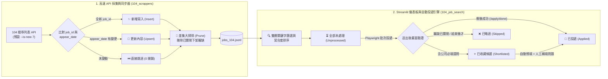

<a id="readme-top"></a>

<div align="center">

# 🚀 Job Search Tools (`Job_Search_Tools`)

**生產級智能求職情報採集、多維度精準篩選與 Playwright 自動化投遞平台**

[](./README.md)
[](./README.zh-TW.md)

<br/>

[](https://www.python.org/)
[](https://streamlit.io/)
[](https://playwright.dev/)
[](https://github.com/astral-sh/uv)
[](#-隱私安全與投遞證明截圖)

<p align="center">
  <a href="#-核心亮點">✨ 核心亮點</a> •
  <a href="#-專案目錄結構">📁 目錄結構</a> •
  <a href="#️-環境安裝與快速啟動">🛠️ 快速安裝</a> •
  <a href="#-104-人力銀行模組指南">💼 104 指南</a> •
  <a href="#-執行指令與工作流">⚡ 執行指令</a> •
  <a href="#-隱私安全與投遞證明截圖">🔒 隱私保護</a>
</p>

</div>

---

## ✨ 核心亮點

`Job_Search_Tools` 採用模組化多平台架構設計，支援主流求職平台（目前已完整支援 **104 人力銀行**，並預留 **Indeed**、**LinkedIn**、**JobStreet** 與 **CakeResume** 擴充架構），從底層 API 高速採集、雜訊過濾、契合度排序到真實瀏覽器自動投遞一氣呵成。

<table>
  <tr>
    <td width="50%" valign="top">
      <h3>⚡ 三合一高速 API 同步引擎</h3>
      <ul>
        <li><b>直連 JSON API 極速採集</b>：繞過笨重的網頁渲染，單次請求直接打包回傳 30 筆完整職缺（含工作內容全文、薪資上下限與經歷要求）。</li>
        <li><b><code>appear_date</code> 智慧比對更新 (Upsert)</b>：在記憶體中交叉比對 <code>(job_id, appear_date)</code>，未變動職缺以 <code>0ms</code> 瞬間跳過；有更新才覆寫內容。</li>
        <li><b>視窗感知差集大掃除 (Pruning)</b>：自動比對差集將已下架關閉的職缺從 <code>jobs_104.jsonl</code> 刪除，無須等到投遞時才發現。</li>
      </ul>
    </td>
    <td width="50%" valign="top">
      <h3>🎯 雙層精準篩選與契合度排序</h3>
      <ul>
        <li><b>側邊欄 <code>OR</code> + 頂部檢索框 <code>AND</code> 交集</b>：側邊欄鎖定核心技術棧（全文比對），頂部檢索框精準鎖定職稱與公司名稱。</li>
        <li><b>英文單字邊界防誤判 (Word Boundary)</b>：自動為純英文關鍵字加上正規表達式邊界保護，<code>AI</code> 絕不誤判 <code>email</code>，<code>RAG</code> 絕不誤判 <code>storage</code>。</li>
        <li><b>自動契合度排序 (<code>🔥 命中 N 項</code>)</b>：依「職稱命中數」與「總關鍵字命中數」由高至低自動排序，最契合的極品職缺永遠排在第 1 頁。</li>
      </ul>
    </td>
  </tr>
  <tr>
    <td width="50%" valign="top">
      <h3>🤖 真實送出驗證與自動分流</h3>
      <ul>
        <li><b>多瀏覽器支援</b>：原生支援 Brave、Chrome、Edge 與 Firefox，直接沿用本地登入狀態。</li>
        <li><b>嚴格送出後驗證</b>：確認跳轉至 104 官方 <code>應徵成功 (/job/apply/done)</code> 畫面並自動截圖存證，才計入已投遞。</li>
        <li><b>異常智慧分流</b>：遇到已關閉職缺於 1 秒內自動排入 <code>skipped</code>；遇到公司自訂必填問卷自動轉入 <code>shortlisted</code> 收藏候選。</li>
      </ul>
    </td>
    <td width="50%" valign="top">
      <h3>✍️ 半自動補填模式與隱私保護</h3>
      <ul>
        <li><b>收藏候選預填停駐模式</b>：在「⭐ 已收藏候選」點擊 <b>🚀 立即投遞</b>，系統會自動選妥履歷、填好推薦信並<b>停留在投遞視窗</b>，讓你直接手填額外問題並送出。</li>
        <li><b>100% 本地個人隱私保護</b>：自薦信模板 (<code>default_cv.json</code>)、投遞紀錄 (<code>user_pipeline.json</code>) 與瀏覽器 Cookie 均受 <code>.gitignore</code> 嚴格保護，絕不上傳 GitHub。</li>
      </ul>
    </td>
  </tr>
</table>

---

## 🔄 系統架構與職缺狀態生命週期



<p align="right">(<a href="#readme-top">⬆️ 回到頂部</a>)</p>

---

## 📁 專案目錄結構

```text
Job_Search_Tools/
├── .gitignore                  # 排除本地資料庫、venv、瀏覽器狀態、截圖與個人隱私檔案
├── README.md                   # 專案說明文件 (English)
├── README.zh-TW.md             # 專案說明文件 (繁體中文)
│
├── 104/                        # 平台 1：104 人力銀行套件 (Active)
│   ├── 104_scrappers/          # 104 職缺爬蟲與職務分類資料
│   │   ├── crawl_listings.py   # 三合一職缺列表同步器（新增 + 更新 + 已關閉大掃除）
│   │   ├── scraper.py          # 104 REST API 核心爬蟲（含防封鎖與退避機制）
│   │   └── data/               # 爬蟲資料目錄
│   │       ├── target_categories.json # 欲採集的目標職務類別清單（可自由增減）
│   │       ├── job_categories.json    # 104 官方完整職務分類代碼樹
│   │       └── jobs_104.jsonl         # 採集之職缺原始資料庫（本地 / gitignored）
│   │
│   └── 104_job_search/         # 104 互動式檢索儀表板與自動投遞系統
│       ├── app.py              # Streamlit 互動式網頁介面與批次投遞中樞
│       ├── applier.py          # Playwright 真實瀏覽器自動投遞核心模組
│       ├── login_tool.py       # 104 瀏覽器登入授權與持久化輔助工具
│       ├── db_sync.py          # SQLite 資料庫同步與 UPSERT 工具
│       ├── query_filter.py     # 命令列多條件快速篩選工具
│       ├── browser_data/       # 瀏覽器持久化 Profile 與登入 Cookie（本地 / gitignored）
│       ├── screenshots/        # 投遞成功證明與診斷截圖（本地 / gitignored）
│       └── data/               # 使用者個人設定與狀態（嚴格本地 / gitignored）
│           ├── filter_rules.json      # 負向雜訊排除規則（硬體韌體、假AI標註、保全等）
│           ├── default_cv.json        # 自訂自我推薦信模板（本地 / gitignored）
│           └── user_pipeline.json     # 投遞進度與職缺狀態紀錄（本地 / gitignored）
│
├── indeed/                     # 平台 2：Indeed 套件 (Planned)
├── linkedin/                   # 平台 3：LinkedIn 套件 (Planned)
└── jobstreet/                  # 平台 4：JobStreet 套件 (Planned)
```

---

## 🛠️ 環境安裝與快速啟動

本專案使用 [`uv`](https://github.com/astral-sh/uv) 進行極速 Python 虛擬環境與套件管理。

```bash
# 1. 複製儲存庫
git clone https://github.com/jeniebeez/Job_Search_Tools.git
cd Job_Search_Tools

# 2. 建立 Python 3.12 虛擬環境並啟用
uv venv --python 3.12
source .venv/bin/activate

# 3. 安裝相依套件與 Playwright 瀏覽器驅動
uv pip install requests pandas openpyxl beautifulsoup4 streamlit playwright
playwright install chromium
```

<p align="right">(<a href="#readme-top">⬆️ 回到頂部</a>)</p>

---

## 💼 104 人力銀行模組指南 (`104/`)

### 1. 核心子模組架構

#### A. 高速 API 採集與三合一同步器 (`104/104_scrappers/`)
- **直連 REST JSON API**：直接呼叫 104 內部搜尋列表 API，每發送 1 次請求即可取得整頁 30 筆職缺的完整資訊（含 `description` 工作內容全文、薪資範圍、經歷學歷要求與 `appearDate` 更新日）。
- **職務分類遍歷**：依據 `target_categories.json` 中的 46 個細項職務類別巡邏，突破 104 單一搜尋最多顯示 100 頁的限制。
- **防封鎖保護機制**：
  - 列表翻頁輕量隨機延遲（`0.6s ~ 1.2s`），兼顧高速同步與帳號/IP 安全。
  - 內建 HTTP `429` / `403` 指數退避自動重試（Exponential Backoff）與真實瀏覽器 User-Agent 輪替。
- **三合一智慧同步更新（預設 `--is-new 7`）**：
  執行 `crawl_listings.py` 時，系統會自動完成以下三件事：
  1. **舊有職缺的比對與更新 (`appear_date` Upsert)**：交叉比對 `(job_id, appear_date)`，若 `appear_date` 相同（例如你在第 5 天提早更新，或同職缺跨類別重複出現）則直接跳過不浪費資源；若 `appear_date` 有變則自動更新職缺內容。
  2. **已關閉職缺的刪除 (Window-Aware Set-Difference Pruning)**：在掃描完成後，直接針對該時間視窗（`appear_date >= cutoff_date`）計算差集（`existing_records - seen_job_ids`），將已從 104 下架關閉的職缺直接從 `jobs_104.jsonl` 刪除（無須等到投遞時才發現，也不會誤刪更早之前仍開放的職缺），並同步清理或還原 `user_pipeline.json` 中的 `"職缺已關閉"` 項目。
  3. **嶄新職缺的新增 (Insert)**：將新上架的 `job_id` 自動寫入 `jobs_104.jsonl`。

#### B. 雙層關鍵字檢索與篩選語法指南 (`app.py`)
Streamlit 儀表板結合了 **側邊欄 `OR`（聯集）** 與 **頂部檢索框 `AND`（交集）** 的雙階段過濾與排序機制：

1. **左側邊欄 `"🏷️ 技能標籤 / 關鍵字過濾"`（全文 `OR` 篩選 + 契合度自動排序）**：
   - **比對範圍**：`職稱 + 職務類別 + 完整工作內容描述 (description)`。
   - **逗號分隔（`,` 或 `，`）與空白自動清理**：支援半形與全形逗號，前後空白自動透過 `.strip()` 忽略。
   - **英文單字邊界保護**：純英文關鍵字（如 `AI`、`RAG`、`LLM`）自動啟用正規表達式單字邊界 `(?<![a-z0-9])...(?![a-z0-9])`，防止 `RAG` 誤中 `storage` 或 `AI` 誤中 `email`。
   - **契合度自動排序 (`🔥 命中 N 項`)**：自動依「(1) 職稱命中數」與「(2) 總關鍵字命中數」由高至低排序，將最精準的職缺排在第 1 頁。

> [!TIP]
> **黃金雙層篩選配置建議**：
> 1. **左側邊欄「🏷️ 技能標籤 / 關鍵字過濾」** 輸入**技術與領域關鍵字**（如：`LLM, RAG, LangChain, Multi-Agent, 生成式AI, 生成式 AI, GenAI, 大語言模型`）。
> 2. **頂部「🔍 即時檢索職缺」** 選擇 **`🎯 僅職稱與公司名 (精準鎖定)`**，並輸入**目標職稱**（如：`工程師, Engineer, Developer, 演算法, 研究`）。
> 如此即可達成「工作內容有做目標技術 **且 (AND)** 職稱是工程師/研究員」的極致精準鎖定！

2. **頂部 `"🔍 即時檢索職缺"` 搜尋框（職稱 / 角色 `AND` 精煉）**：
   - **`🎯 僅職稱與公司名 (精準鎖定)`（預設）**：僅比對職缺標題與公司名稱。
   - **`📄 全文檢索 (含工作內容)`**：比對職稱、公司名稱、工作內容全文與地區。

---

### 2. 職缺處理狀態定義 (`unprocessed`, `shortlisted`, `applied`, `skipped`)

記錄於 `104/104_job_search/data/user_pipeline.json` 的每筆職缺皆屬於以下四種狀態之一（可於左側邊欄「職缺處理狀態」切換檢視）：

| 狀態代碼 | 介面顯示名稱 | 代表意義與觸發方式 |
| :--- | :--- | :--- |
| **`unprocessed`** | **⏳ 全部未處理** | **預設狀態**：所有剛採集下來、尚未投遞、收藏或略過的職缺。 |
| **`shortlisted`** | **⭐ 已收藏候選** | **1. 手動收藏 / 自動轉入必填問卷職缺 (`⚠️ 含公司必填提問`)**：手動點擊 `⭐ 收藏` 的職缺，或在批次自動投遞時偵測到該公司設有「自訂必填問題 (`此為必填問題`)」無法自動送出的職缺。<br>**2. 專屬半自動補填工作流**：此分頁會自動隱藏頂部批次投遞按鈕；點擊卡片上的 **`🚀 立即投遞`** 後，系統會開啟瀏覽器、選好履歷、填妥推薦信，並**停留在投遞視窗**等待你手填額外問題並送出（送出後自動歸檔，亦可點擊卡片上的 **`✅ 已投遞`** 手動歸檔）。 |
| **`applied`** | **🚀 已投遞** | **已確認送出之職缺**：經 Playwright 驗證出現 104 官方 `應徵成功 (/job/apply/done)` 畫面，或手動點擊 **`✅ 已投遞`** 按鈕歸檔之職缺。會自動從「全部未處理」中排除，絕不重複投遞。 |
| **`skipped`** | **❌ 已略過** | **1. 手動略過**：點擊卡片上 `❌ 略過` 的職缺。<br>**2. 自動轉入已關閉職缺 (`❌ 職缺已關閉`)**：自動投遞時若 104 顯示職缺已關閉或結束徵才，引擎會在 1 秒內中止並自動標記為 `skipped`（並在下次執行 `crawl_listings.py` 時從資料庫徹底剔除）。 |

---

### 3. 自薦信管理與自訂爬蟲類別

<details>
<summary><b>📝 點擊展開：自薦信模板管理與持久化機制 (<code>default_cv.json</code>)</b></summary>
<br/>

1. **首次啟動自動生成**：
   首次執行 `streamlit run 104/104_job_search/app.py` 時，若 `104/104_job_search/data/default_cv.json` 不存在，系統會自動建立預設模板。
2. **兩種編輯與儲存方式**：
   - **方式 A（推薦）**：直接在 Streamlit 左側邊欄修改文字，點擊 **「💾 儲存此模板修改」** 或 **「➕ 另存為新模板」** 即可永久寫入硬碟。
   - **方式 B**：直接用編輯器打開 `104/104_job_search/data/default_cv.json` 修改。
3. **嚴格隱私保護**：
   `default_cv.json` 已列入 `.gitignore`，你的姓名、聯絡方式、作品集連結與自薦信內容絕不會被上傳至 GitHub。

</details>

<details>
<summary><b>🗂️ 點擊展開：如何自訂要爬取的職務類別與關鍵字 (<code>target_categories.json</code>)</b></summary>
<br/>

1. **查詢職務代碼**：
   打開 `104/104_scrappers/data/job_categories.json` 搜尋目標職務名稱（`"no"` 為代碼，`"des"` 為職務名稱）。
2. **編輯 `target_categories.json`**：
   ```json
   [
     {
       "code": "2007001012",
       "name": "演算法開發工程師",
       "parent_name": "軟體/工程類人員"
     },
     {
       "code": "2007001001",
       "name": "軟體工程師",
       "parent_name": "軟體/工程類人員"
     }
   ]
   ```
3. **依特定關鍵字單次爬取 (`scraper.py`)**：
   ```python
   if __name__ == "__main__":
       scraper = Job104Scraper()
       for kw in ["機器學習", "Python 後端", "量化交易"]:
           scraper.crawl_query(keyword=kw, max_pages=3, fetch_details=False)
       # 或直接指定職務類別代碼：
       # scraper.crawl_query(jobcat="2007001012", max_pages=5)
   ```

</details>

<p align="right">(<a href="#readme-top">⬆️ 回到頂部</a>)</p>

---

## ⚡ 執行指令與工作流

### 🔹 指令 1：首次瀏覽器登入授權（選用）
```bash
python 104/104_job_search/login_tool.py
```
- 開啟專屬瀏覽器視窗供你登入 104，並將登入狀態永久保存於本地 `104/104_job_search/browser_data/`。（亦可直接點擊 Streamlit 介面左側邊欄的 **「🔑 檢查 / 開啟 104 登入視窗」** 按鈕）。

### 🔹 指令 2：職缺列表高速採集與三合一同步更新
```bash
# 預設執行 (--is-new 7)：針對過去 7 天內更新的職缺執行「舊職缺更新 + 已關閉刪除 + 新職缺新增」
python 104/104_scrappers/crawl_listings.py

# 選用參數：自訂要查看/同步最近 N 天內更新的職缺清單 (0=本日, 3=3日內, 7=1週內[預設], 14=2週內, 30=1個月內)
python 104/104_scrappers/crawl_listings.py --is-new 3
```
> [!NOTE]
> 如果你本地的 `jobs_104.jsonl` 近期已經更新過，今天只是要篩選職缺或進行自動投遞，**請直接跳過指令 2**，執行下方的指令 3 即可！

### 🔹 指令 3：啟動 Streamlit 互動儀表板與自動投遞系統（日常主力 ⭐）
```bash
streamlit run 104/104_job_search/app.py
```
- 啟動本地互動網頁介面（`http://localhost:8501`）。
- 篩選職缺、選擇自薦信模板後，點擊 **「🚀 依序投遞全部 N 筆篩選職缺」** 即可在背景執行自動投遞（投遞期間你可以正常使用電腦進行其他工作）；針對轉入 **「⭐ 已收藏候選」** 的職缺，點擊卡片上的 **「🚀 立即投遞」** 即可自動預填並手動補填公司問卷。

---

## 🔒 隱私安全與投遞證明截圖

> [!IMPORTANT]
> 本專案透過 `.gitignore` 嚴格保護所有個人資料與執行產物，絕不外洩至遠端儲存庫：
> - **`browser_data/`**：本地瀏覽器 Cookie 與登入連線狀態。
> - **`*.jsonl`, `*.db`**：本地爬取的職缺資料庫。
> - **`data/user_pipeline.json`, `data/default_cv.json`**：個人投遞歷史紀錄與自薦信草稿。
> - **`screenshots/`**：每次投遞的成功確認畫面截圖與診斷截圖（可隨時手動刪除以釋放空間）。

---

## ⚖️ 免責聲明

本專案僅供個人求職情報分析、學術研究與技術交流使用。使用者應自行遵守目標求職平台之服務條款（Terms of Service）與合理使用規範，作者不對任何不當使用或服務中斷承擔責任。

<p align="right">(<a href="#readme-top">⬆️ 回到頂部</a>)</p>
